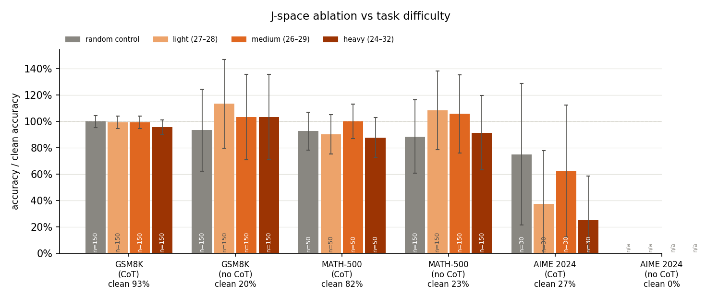
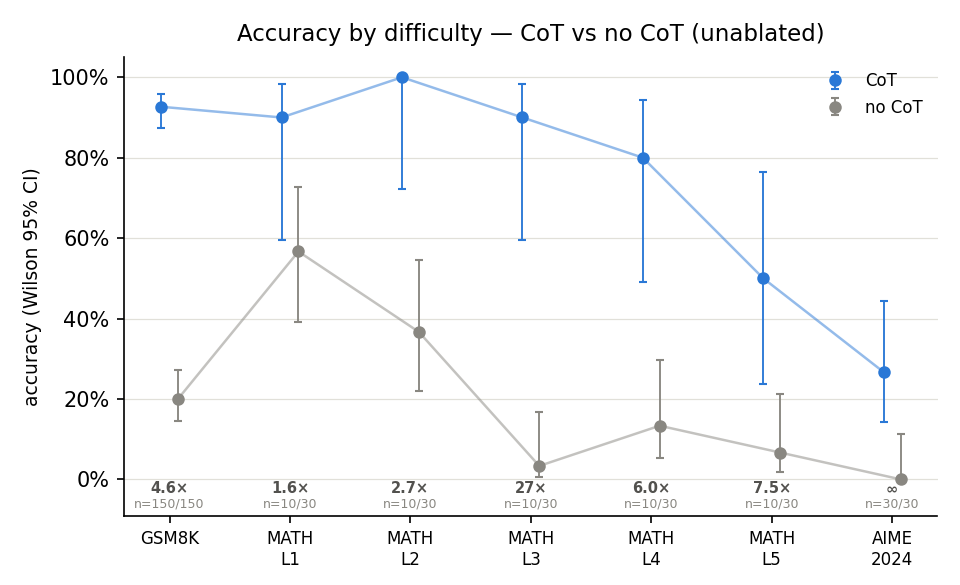
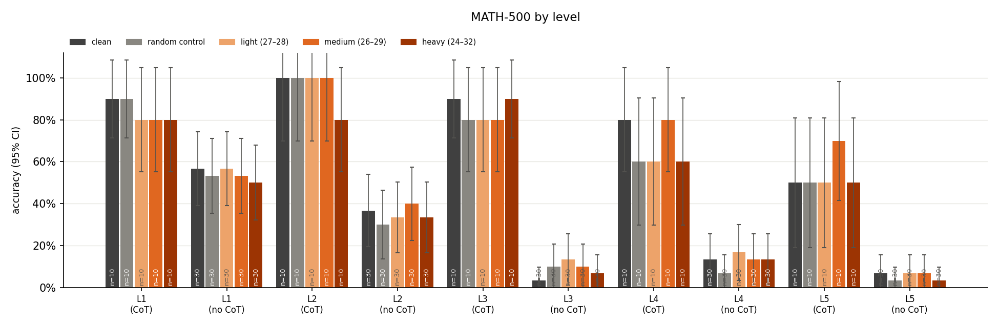

# Model Workspace Knockout

**Does chain of thought protect a model when you knock out its internal workspace?**

[Gurnee et al. (2026)](https://transformer-circuits.pub/2026/workspace/index.html)
describe a "J-space": the residual-stream directions that a Jacobian lens reads
as concepts the model is getting ready to say. Project those directions out and
flexible reasoning breaks. GSM8K solved *with* chain of thought mostly survives,
though. The natural reading is that CoT moves intermediate results out of the
activations and onto the page, so there's less internal state left to destroy.

This project extends that result along one axis: difficulty. I ran
**Qwen3-4B** on GSM8K → MATH-500 levels 1–5 → AIME 2024, with and without CoT,
under three strengths of J-space ablation and a norm-matched random control.

**Short version:** CoT's advantage grows with difficulty, as expected. The
ablation, though, does almost nothing to *either* arm until AIME, and even
there I can't separate it from generic perturbation.



*Accuracy under each ablation relative to that arm's own clean baseline,
paired on identical problems (format adapted from Gurnee et al., Fig. 24).
AIME no-CoT shows n/a because its baseline was 0/30.*

## Hypotheses

1. **The CoT gap widens with difficulty.** Harder problems need more
   intermediate results held somewhere, so the gap between CoT and no-CoT
   accuracy should grow from GSM8K to MATH L1–5 to AIME. A flat or shrinking
   gap would count against it.
2. **Ablation hurts no-CoT more.** With CoT, the reasoning is already written
   down, so ablation should matter little at any difficulty. Without CoT, the
   model has nowhere else to keep it. Confirming evidence would be: no-CoT
   drops well below its baseline under J-space ablation, CoT stays near its
   baseline, the random control moves neither, and the no-CoT drop grows with
   difficulty wherever the baseline leaves room to fall.

## Results

Accuracy, clean → heavy ablation (layers 24–32):

| | CoT | no CoT |
|---|---|---|
| GSM8K (n=150) | 92.7% → 88.7% | 20.0% → 20.7% |
| MATH-500 (n=50 CoT / 150 no-CoT) | 82.0% → 72.0% | 23.3% → 21.3% |
| AIME 2024 (n=30) | **26.7% → 6.7%** (p = 0.03) | 0% → 0% |

Nothing else is significant at p < 0.05 (paired exact McNemar against each
arm's own clean run). The closest is AIME CoT under the light tier,
26.7% → 10.0% (p = 0.06). The full table is at the bottom of
[`Main.ipynb`](Main.ipynb).

### H1 holds over the range where CoT is reliable

Unablated, CoT beats answering directly by 4.6× on GSM8K and 27× on MATH
level 3, while no-CoT accuracy collapses. At AIME the gap narrows, but only
because CoT itself falls to 27%. Past that point the gap is bounded by what
CoT can do, not by how much the problem needs it.



### H2 fails: no-CoT doesn't notice the ablation

I expected answering directly to be the fragile arm. It wasn't. On GSM8K and
MATH-500, no ablation tier, and not the control either, moved either arm
significantly away from its baseline. The biggest drop, MATH CoT under heavy
ablation (82% → 72%), has p = 0.13. That held even on GSM8K and MATH L1–2, where the no-CoT
baseline (20–57%) had room to fall. The per-level breakdown shows the same
thing:



My best guess is that at 4B, no-CoT answers on these problems mostly come
from pattern matching rather than multi-step internal computation, so there's
no workspace reasoning to break. That's a guess, not something this
experiment tests.

### AIME with CoT is the only place anything moves, and it looks like loops

Every AIME CoT condition, the random control included, sits below the clean
baseline. The loop detector fired on 23/30 heavy-ablated generations vs 6/30
clean, and the random control loops 13/30 times and drops accuracy to 20%.
The calibration below also shows that this random control is about as
disruptive as the light J-space tier. So the AIME drop looks like damage to
the model's ability to keep a long generation on track, and at n = 30 it
can't be separated from generic perturbation. AIME no-CoT tells us nothing,
because its baseline is 0/30.

## Method

**Design.** Two factors are crossed: answering mode (CoT vs no-CoT) and
condition (clean, three J-space tiers, random control). The outcome is
exact-answer accuracy, always on the same frozen problems, so every
comparison is paired.

**Data.** 150 GSM8K, 150 MATH-500 (30 per level, stratified), and all 30 AIME
2024 problems, drawn once with seed 288 and frozen in
`artifacts/sample_ids.json`. MATH-500 CoT runs on a 10-per-level subset to
keep GPU time manageable.

**Lens.** The pre-fitted Qwen3-4B Jacobian lens from
[Neuronpedia](https://huggingface.co/neuronpedia/jacobian-lens) (fit on
wikitext-103, early-stopped at 479 prompts), applied with Anthropic's
[`jacobian-lens`](https://github.com/anthropics/jacobian-lens) package
(vendored in `jacobian-lens/`).

**Ablation.** At every position of every layer in a band:
1. score the whole vocabulary through that layer's lens;
2. take the top k = 25 concepts;
3. project their joint span out of the residual stream.

The clean model's top-3 next tokens are spared, so the edit targets what the
model is thinking about rather than what it's about to say. There are three
tiers: light (27–28), medium (26–29) and heavy (24–32).

**Random control.** At the heavy band, remove the same norm along fixed
random directions. The norm is matched on the fly to what the treatment
would remove from that exact state.

**Prompting and decoding.** Qwen's thinking mode is off in both arms, and
decoding is greedy throughout.
- No-CoT prefills `Final answer:` and is graded on its first line only
  (128-token cap).
- CoT asks for step-by-step reasoning ending in `Final answer:`. Its caps
  (1024 / 4096 / 6144 tokens for GSM8K / MATH / AIME) leave headroom above
  the length of correct clean solutions (MATH p99 ≈ 2.1k tokens, longest
  correct AIME ≈ 1.9k), and a repetition detector stops degenerate loops
  early.

**Grading.**
- GSM8K and AIME: numeric equality on the first number in the answer.
- MATH-500: [`math-verify`](https://github.com/huggingface/Math-Verify)
  symbolic equivalence, with a string fallback.
- CoT answers come from the last `\boxed{}`, because Qwen ignores the
  requested format on competition maths.

### Checking the instrument before trusting a null result

A null result is only worth something if the ablation demonstrably works.
Three checks ran before any dataset:

- **The scorer matches the reference.** My top-5 concept readout matches the
  `jlens` package's on the verification prompts.
- **The ablation does what it says.** Selected concepts' lens scores fall
  from about 1.7 × 10³ to about 2 × 10⁻³, a factor of about 10⁻⁶. The random
  control's removal norm matches the treatment's (mean ratio 1.0000).
- **It breaks multihop reasoning, and the random control doesn't.** This
  reproduces the paper's own validity check: two-hop prompts with an
  unwritten bridge entity ("the animal that spins webs" → *spider* → 8).

| config | multihop acc | random control |
|---|---|---|
| clean | 0.83 | |
| paper's settings, mapped directly (L19–28, k=10, N=10) | 0.92 | 0.83 |
| heavy L24–32, k=25, N=10 | 0.58 | 0.75 |
| **heavy L24–32, k=25, N=3** (used) | **0.50** | 0.75 |

Copying the paper's settings onto Qwen did nothing. Two changes fixed that:

1. **Moving the band later.** In the lens readouts, Qwen's workspace sits
   around L22–34. For example, *Italy* appears at L23 and *euro* by L29 on
   "the currency of the country shaped like a boot".
2. **Narrowing the exclusion set from N=10 to N=3.** On short prompts the
   clean top-10 already contains the intermediate (*spider* is rank 2), so the
   paper's rule ends up protecting exactly what the ablation is meant to remove.

To compare tier strengths with the paper, I measured how often the ablated
model's top-1 prediction on wikitext agrees with the clean model's:

| | light | medium | heavy | random |
|---|---|---|---|---|
| this work (k=25) | 0.77 | 0.73 | 0.62 | 0.76 |
| Gurnee et al. (k=10) | 0.87 | 0.75 | 0.65 | 0.96 |

Medium and heavy line up with the paper's tiers. The random control is much
more disruptive here than in the paper, roughly as strong as the light tier,
which is part of why it's hard to read the AIME result.

These settings were then frozen for every experiment.

## Repo layout

```
Main.ipynb            the full experiment, end to end, with outputs
jspace/               experiment code
  ablation.py           J-space projection, random control, forward hooks
  generation.py         prompts, greedy decoding, repetition-loop stop
  grading.py            answer extraction + numeric / symbolic grading
  calibration.py        multihop + prompt-token-match checks
  runner.py             resumable (problem × condition × arm) → CSV runner
  plots.py, stats.py    figures, Wilson CIs, exact McNemar
tests/                CPU test suite (tiny random Qwen3, no downloads)
results/*.csv         every generation's prediction, gold, and grade
artifacts/            frozen problem ids (seed 288)
figures/              figures above, regenerated from results/
jacobian-lens/        vendored copy of anthropics/jacobian-lens (Apache-2.0, unmodified)
```

## Running it

**Tests** run on a laptop in a few seconds, no GPU or downloads needed:

```bash
pip install -e ".[dev]"
pytest
```

They cover:
- the ablation maths: selected concepts are silenced, the control matches
  the treatment's norm, and hooks always detach;
- answer extraction on the odd formats Qwen actually produces;
- the runner's resume logic;
- a check that re-grading every row in `results/` reproduces the stored score.

**The experiment** needs an A100-class GPU (about 40 GB). It was built for
Colab:

1. Put this folder in Google Drive at `MyDrive/model-workspace-knockout`.
2. Open `Main.ipynb` in Colab on an A100 runtime and run all cells.
   The first run downloads Qwen3-4B (~8 GB) and the lens.

On any other GPU machine, start Jupyter from the repo root: outside Colab the
notebook treats the current directory as the project folder.

The runner skips rows already in `results/`, so with the committed CSVs a full
run only redoes the checks, calibration and figures (minutes). Delete the CSVs
to regenerate everything from scratch (many GPU-hours, mostly CoT on AIME and
MATH).

## Caveats

- **Small samples.** There are only 30 AIME problems, and MATH-500 CoT uses
  10 problems per level, so most confidence intervals are wide.
- **Narrow setup.** One model, one seed, greedy decoding, and a lens
  early-stopped at 479 fitting prompts.
- **Adapted settings.** The bands, k and N differ from the paper's (see
  above), so this is an extension of their setup rather than an exact
  replication.
- **Imperfect MATH-500 grader.** `math-verify` misparses some unwrapped
  answers (e.g. `(15, -29)` against gold `(15,-29)`). A stricter variant I
  tried flips 44 of 1,000 rows, in both directions. I kept the original
  grader so the stored results stay reproducible, and the known failure is
  pinned as an `xfail` test.

## Credits

This builds on Anthropic's work on the J-space and is not affiliated with or
endorsed by Anthropic.

> Gurnee et al. (2026). *Verbalizable Representations Form a Global Workspace
> in Language Models.* Transformer Circuits Thread.
> https://transformer-circuits.pub/2026/workspace/index.html

- **Lens method and the `jlens` package:** Anthropic (Apache-2.0), vendored
  unmodified.
- **Pre-fitted Qwen3-4B lens:** Neuronpedia (MIT).
- **Model:** [Qwen3-4B](https://huggingface.co/Qwen/Qwen3-4B).
- **Data:** [GSM8K](https://huggingface.co/datasets/openai/gsm8k),
  [MATH-500](https://huggingface.co/datasets/HuggingFaceH4/MATH-500),
  [AIME 2024](https://huggingface.co/datasets/HuggingFaceH4/aime_2024).
- Started as homework 0 for Harvard CS 2881.
